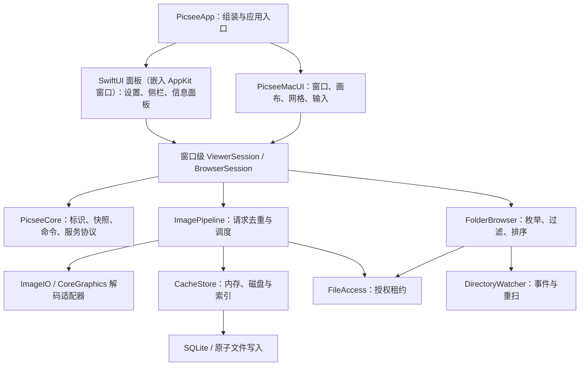

# picsee 架构设计

版本：v0.2 · 更新：2026-10-21 · 状态：可用于拆分开发任务的设计草案，尚无实现或性能验收结果。

已确定技术路线：**Swift + SwiftUI + AppKit**。配套文件：[分阶段开发计划](./PICSEE_DEVELOPMENT_PLAN.md)。

## 1. 目标、依据与设计边界

picsee 是面向 macOS 的本地图片浏览工具，优先解决 Finder 打开图片后的连续浏览、缩放拖动、文件夹网格和桌面对照。首发以直接浏览文件系统为核心；不要求用户先导入图片库。

依据：

- Picview 技术报告 `docs/PICVIEW_ANALYSIS.md`（本地研究资料，不在公开仓库），特别是第 9 节的加载、缓存、目录与事件监听分析。
- Picview 功能清单 `docs/PICVIEW_FEATURES.md`（本地研究资料，不在公开仓库），包含官方宣传和本地资源证据，二者已区分。
- 用户已确定专注 macOS，使用 Swift、SwiftUI 和 AppKit。

**本文件的类名、缓存策略、并发参数、性能目标均为 picsee 的设计建议，不是恢复出的 Picview 源码。** Picview 的缓存键、淘汰算法、预取距离仍未被验证，不能作为已知实现照搬。

### 1.1 从 Picview 采纳的经验

| Picview 已观察到的事实 | picsee 采用的设计 | 不直接复制的部分 |
|---|---|---|
| 可取消的图像 Operation，多个独立串行队列 | 主动区分当前图片、可见缩略图、预取和磁盘写入；并发与内存共同限流 | 不把其四条串行队列当作最优参数 |
| ImageIO 按目标尺寸生成缩略图 | 网格和视口预览按像素尺寸解码，保留方向与色彩信息 | 不默认全部先解码原图再缩放 |
| 独立文件缩略图存储，后台编码 | 内存与磁盘分层，缓存版本化，可重建 | 不照抄 0.67 编码质量或推断未知缓存键 |
| Folder/URL 容器、过滤与排序列表 | 文件系统是事实源，以稳定标识和版本化快照驱动浏览 | 不复刻其类层级或未知索引算法 |
| FSEvents 和 Finder 排序相关代码 | 目录事件触发重扫；Finder 跟随排序列为后续兼容增强 | 不把事件当作完整、无丢失的事务日志 |
| AppKit 窗口与输入相关类，SwiftUI 链接 | AppKit 管画布与窗口行为；SwiftUI 管常规界面 | 不假设 Picview 所有界面都使用 SwiftUI |

### 1.2 本轮默认决策

以下是为了让计划可执行而采用的默认值，均不是用户已经指定的要求；在 P0 记录验证结果，改变它们时更新对应决策记录。

| 项目 | 默认方案 | 影响 |
|---|---|---|
| 系统下限 | macOS 14+ | 控制兼容成本；具体高级 API 仍使用可用性检查 |
| 首发硬件 | Apple Silicon；Intel 暂不承诺 | 核心模块不故意绑定 ARM，但 Intel 需另建验证矩阵 |
| 构建 | 原生 Xcode App target + 本地 Swift Package；Swift 6 语言模式 | Xcode 版本以 P0 本机可运行且匹配 SDK 的稳定工具链为准，锁定到 CI |
| 分发 | 首发按启用 App Sandbox 的 Developer ID 应用设计，签名、公证后直接下载 | 提前验证目录授权；首发经 GitHub Releases 分发并用 Sparkle 2 自动更新（[ADR-006](./adr/0006-sandbox-from-p0-direct-distribution.md)）；Mac App Store 另作发布决策 |
| 应用结构 | 单进程、模块化；按需预留解码服务边界 | 首版不自建 XPC 服务（Sparkle 自带的安装器与下载 XPC 是例外，见 ADR-006），不引入 Rust、Web 前端或云服务 |
| 数据 | 图片原地访问，编辑默认另存；缓存可删除重建 | 不建立必须先导入的图片资产库 |
| 语言 | 简体中文、英文；String Catalog 从首个界面建立 | 不在业务层硬编码显示文案 |
| 网络与统计 | 首版核心功能离线；本地 Logger/signpost | 无账号、云同步和默认遥测依赖 |

### 1.3 首发功能层次

- **MVP（P0–P3）**：打开/拖入图片与目录，授权后连续浏览，适应/实际像素/缩放平移，C显隐工具与浅深主题，整合式Filmstrip，基础网格/多选、过滤排序、图片基础菜单与基础Inspector、收藏/最近查看、目录刷新和有界缓存。
- **首发 v1（P4–P6）**：多窗口、图片/文本置顶、可配置交互、幻灯片、高级元数据检查、标签、基本裁剪旋转翻转与导出、受测格式、可访问性和分发验收。
- **增强版（P7）**：OCR/主体提取、增强 RAW、HDR、Finder 跟随排序、复杂布局及更多格式。增强项不得阻塞基础浏览首发。

## 2. 总体结构与依赖



### 2.1 保持少量编译模块，内部按职责分目录

初期采用 5 个 production targets，避免每个服务单独成为一个 package。后续只在编译时间或依赖隔离有收益时拆分。

| Target | 职责与可依赖范围 | 不负责的事情 |
|---|---|---|
| `PicseeApp` | App 生命周期（`NSApplicationDelegate`）、服务组装、打开事件、SwiftUI 面板；窗口由 AppKit 拥有（[ADR-001](./adr/0001-appkit-owns-windows.md)）；依赖其他模块 | 不内嵌缓存/解码算法 |
| `PicseeMacUI` | AppKit 画布、网格、窗口、输入；依赖 Core 与 Application | 不直接读磁盘、枚举目录或拼缓存路径 |
| `PicseeCore` | 值类型、命令、错误、标识、服务协议；Foundation/CoreGraphics 范围内 | 不引用 SwiftUI、AppKit 控件、数据库或具体解码器 |
| `PicseeApplication` | 窗口 Session、应用用例、状态协调；依赖 Core | 不创建 NSWindow，不执行阻塞文件 I/O |
| `PicseeInfrastructure` | ImageIO、FileAccess、FolderBrowser、CacheStore、事件监听、持久化；依赖 Core | 不知道窗口、cell 或 SwiftUI Binding |

P0-03 首个实验切片（#7）的画布偏离已在 P1-03（#37）结束：可复用绘制与输入在 `Packages/PicseeKit/Sources/PicseeMacUI/Canvas/CanvasView.swift`，Session 持有缩放模式，纯坐标规则在 PicseeCore。画布通过离屏 AppKit 绘制与公开输入入口测试，纳入 package 的 100% 行/函数覆盖率门槛；`App/CanvasInputBridge.swift` 仅提取无法可靠合成的捏合事件字段。窗口与全屏交接仍在 `App/CanvasWindowController.swift`，原生接线不由 package 覆盖率证明。P0-09（#10/#11）纯值命令目录在 Core，Application 的 CommandRouter 现以每窗口 ViewerSession 为目标，由 Session 决定命令启用、选择/预览、chrome 与 Inspector/焦点状态，App 仅实现宿主效果；规则与测试见[开发计划 §1.4 状态表](./PICSEE_DEVELOPMENT_PLAN.md#viewersession-状态表p0-0911)。画布已在 P1-03 迁入 PicseeMacUI，缩放模式由 Session 持有。P0-05/06（#9）已用共享准入 actor 和一条有界 OperationQueue 替换串行执行器；窗口取消自己的订阅，运行中的 File Grant 保留到解码真实返回。P1-04/P1-05（#41）的渐进加载编排由 PicseeApplication 的 `ViewerImageLoader` 持有并经 Session 测试：初始 ≤512px 预览之后请求首个非预览视口档（即使边长相同），放大时才请求更高细节；App 仅提供源获取与原生呈现接线，原生接线仍不由 package 单元测试证明。

Application 通过 Core 中的小型协议调用 Infrastructure；App 是组合根，不建立通用 DI 框架。 原生设计资源与可复用视觉按[组件与原生映射](../design/picsee-ui-system/native/README.md)收敛到现有UI target内的DesignSystem逻辑分组，供SwiftUI/AppKit共享；不新增第六个production target。SwiftUI 页面位于 App/UI，必要的可复用桥接位于 MacUI。测试可使用假服务，真实 I/O 集成测试另行覆盖。

### 2.2 建议目录树

```text
picsee/
├── Picsee.xcodeproj/
├── App/
│   ├── PicseeApp.swift
│   ├── AppDelegate.swift
│   ├── CompositionRoot.swift
│   ├── Commands/
│   ├── UI/                         # SwiftUI 设置、侧栏、Inspector、空态
│   └── Resources/                  # Assets、String Catalog、entitlements
├── Packages/PicseeKit/
│   ├── Package.swift
│   ├── Sources/
│   │   ├── PicseeCore/
│   │   │   ├── Identity/           # ItemID、FileRevision、RequestKey
│   │   │   ├── Models/             # BrowserSnapshot、RenderRequest、EditRecipe
│   │   │   ├── Commands/
│   │   │   └── Ports/              # 具体服务协议与错误
│   │   ├── PicseeApplication/
│   │   │   ├── Viewer/             # ViewerSession、请求代次、选中项
│   │   │   ├── Browser/
│   │   │   ├── Pins/
│   │   │   └── Editing/
│   │   ├── PicseeInfrastructure/
│   │   │   ├── FileAccess/
│   │   │   ├── ImagePipeline/
│   │   │   ├── Decoders/
│   │   │   ├── Cache/
│   │   │   ├── FolderBrowser/
│   │   │   ├── Watching/
│   │   │   └── Persistence/
│   │   └── PicseeMacUI/
│   │       ├── Canvas/
│   │       ├── Grid/
│   │       ├── Windows/
│   │       ├── Input/
│   │       └── Bridges/
│   └── Tests/                      # Core、用例、适配器、组件测试
├── UITests/
├── TestAssets/                     # 合成/获准使用素材及清单，不提交个人照片
├── docs/adr/
└── scripts/                        # 未来构建、性能采样和打包脚本
```

这是未来应用工程结构；当前目录中的 REA/npm 属于研究工具，不是 picsee 的运行时依赖。现有 `evidence/` 和报告保留为研究资料，应用 target 不打包它们。

## 3. 状态、标识与窗口边界

### 3.1 单一状态所有者

- 每个窗口有独立 `@MainActor ViewerSession`：当前位置、目录快照引用、选中项、显示模式、缩放、未保存编辑、加载状态、请求代次。SwiftUI 读取可观察状态；AppKit 通过命令/回调修改 Session。
- 窗口选择模型区分 `selectedItemIDs`、`currentItemID`、`anchorItemID`；Viewer的有序预览集合与来源快照单独保存。多选Space范围按开发计划v0.2的建议默认值在实施前落档，Esc恢复来源选择与滚动锚点。
- C工具显隐由窗口内的明确状态机管理；菜单、Inspector、Filmstrip与键盘焦点作为交互锁定条件。显示偏好与瞬时加载/菜单状态分开持久化；不得散落在SwiftUI和AppKit两套状态中。
- 应用级共享 ImagePipeline、缓存、FileAccess 和 WatchHub；不共享“当前选中图片”。两个窗口的导航、编辑、幻灯片计时互不污染。
- AppKit 控件自己的临时状态仅包括拖动过程、tracking area 等。缩放最终值回写 Session，避免 SwiftUI 与 NSScrollView 各自保存一套真相。
- 桥接器在创建时安装视图，在更新时按差异提交变化；不在 `updateNSView` 里发起解码、重建网格或重置滚动位置。

### 3.2 身份与修订

| 值 | 设计 |
|---|---|
| `AccessRootID` | 用户授权根的应用内 ID；关联 bookmark 与范围，不直接作为永久文件身份 |
| `ItemID` | 授权根内以 AccessRootID + 规范化相对路径建立身份；同路径替换不拆项。卷 UUID 与文件资源标识只细化当前 resolver 观察到的重命名关联，不覆盖既有路径身份；同时存在的根内硬链接路径是不同项。File Grant 无授权根：资源字节可用时采用资源形式，否则为本次 resolver 会话内按规范路径复用的 ephemeral UUID。三种形式均编码为一个版本化字符串，不存运行时对象地址 |
| `FileRevision` | 文件大小、修改时间、必要的资源变更信息与当前监听代次；不以路径相同推断内容相同 |
| `SnapshotVersion` | 目录/过滤/排序条件及扫描代次；旧扫描不得覆盖新导航 |
| `RenderKey` | ItemID + FileRevision + 页/帧 + 像素尺寸档 + 方向/色彩/动态范围策略 + 解码器版本 + 渲染用途 |
| `PresentationToken` | window/cell 绑定 ID + 请求 generation；控制是否仍允许显示结果 |

URL 可变化，资源身份也非在所有文件系统上稳定。同一 resolver 内观察到原路径消失、资源标识移到新路径时保留 ItemID；旧名字被新文件复用时另建身份，避免与已重命名项冲突。重命名关联暂不持久化，跨启动跟踪留给后续图库/监听；跨卷移动视为重新识别。P1-01 临时树测试在同字节数、固定相同修改时间下原子替换 TIFF，ItemID 保持不变，资源标识使 FileRevision 与 RenderKey 改变，落实“同一项的新版本”。文件被原路径替换必须产生新修订；资源信息不可得或同 inode 原地改写且大小/时间不变时，仍需后续文件事件提升修订代次并失效缓存。无事件且元数据完全相同时的可靠内容识别留给可选内容指纹，首版不承诺全量哈希检测。

编码持久性与 Codable 往返是两件事：`id1:root:`（AccessRootID + 规范化相对路径）可跨启动保存；`id1:res:` 中的 fileResourceIdentifier 不保证跨系统重启稳定，`id1:ephemeral:` 也只属于当前会话。`FileRevision.resourceIdentifier` 同样是会话 token。`RenderKey.stableEncoding` 保留全部字段，供会话内比较和去重；P3-03 的磁盘文件名必须对单独的 `persistentEncoding`（`rkp1`）做 SHA-256，不能直接散列 `stableEncoding`。目前仅 root-relative 身份且修订无资源 token 时返回持久化编码；其余返回 nil，调用方跳过持久化。选择拒绝这些 key，是因为直接省略资源 token 会把同大小、同时间的原子替换混为同一修订。正常真实读取含资源 token 时暂不具备跨启动缓存键；P3-03 若要缓存它们，须先引入可靠的持久修订证据（例如内容指纹），不能将会话 token 当成持久值。

### 3.3 打开与授权流程

```text
Finder 打开 / 拖入 / 打开面板
  → 解析输入与类型 → 取得实际可用的访问范围
  → 只有单文件访问：立即显示该文件，提供“授权所在文件夹以连续浏览”
  → 有目录授权：创建扫描请求 → 首批快照 → ViewerSession 定位输入图片
  → 打开新窗口或复用当前窗口：由用户设置决定
```

FileAccess 管理引用计数的 `AccessLease`。先 resolve bookmark，处理 stale bookmark，成功开始访问后才返回租约；最后一个使用者释放时平衡 stop。请求取消、异常、窗口关闭和导出结束均需释放。新请求获取授权后才查找用户图片的缓存，避免权限已撤销却从全局缓存继续暴露原图内容。

单文件授权不能被视为整个父目录授权；使用路径包含判断时检查规范化后的目录边界。首版不自动跟随符号链接出授权根，不循环遍历链接目录；用户明确选择的新范围另行授权。无需 Full Disk Access 也应完成正常核心流程。

## 4. 图片加载与渲染

### 4.1 请求流程

```text
选择图片 → 更新 generation → 取消旧订阅 → 获取 AccessLease
  → 验证 ItemID / Revision → 内存命中？ → 可显示则交付
  → 磁盘命中？ → 校验载荷/元数据 → 受控后台解码
  → 未命中：DecoderRegistry 选择解码器 → 元数据/尺寸检查
  → 按视口像素尺寸解码预览 → 再确认修订与 PresentationToken
  → MainActor 安装结果 → 满足策略则异步写缩略图缓存
  → 放大到更高细节时请求更高像素档；旧预览可暂留并明确仍在细化
```

预览失败展示可恢复的错误，不把上张图片当作新图片完成态。切换时可短暂保留旧画面，但必须标注加载状态；完成回调必须同时匹配 ItemID、Revision、generation 和绑定对象。

### 4.2 异步协调与同步解码分离

- 使用 Swift Task / async-await 表达请求生命周期；actor 保护缓存索引、去重表与调度状态；`MainActor` 只处理呈现。
- ImageIO、RAW 和大文件同步工作放入专用有界 OperationQueue。**把函数标为 async，或放进普通 actor，不等于它不会阻塞 UI/协作线程。**
- 包装 Operation 的 continuation 必须只完成一次：排队前取消、等待中取消、执行中取消与正常完成均需处理。
- P0-05 头部读取在同一有界队列执行（无像素分配），取得尺寸与修订后才进入准入 actor；待处理的像素解码留在 actor，拿齐许可与按头部位深、分量、alpha/浮点标记估算的请求输出字节预约才提交（8 位输出至少 4 字节/像素，并保守计行对齐与方向）。解码器在自身 ImageIO source 上再次核对请求输出预约上限，防止准入后文件变化绕过预算。ImageIO 对不支持 DCT 缩放的格式仍可能暂时解码完整源图，此瞬时开销不在请求输出预约内，仅由 >12 MP 源图重任务 lane 的并发上限约束。头部准备操作不占像素预约，不能把这个预算解释为整个进程 RSS 上限。
- 同步系统解码未必能中途停止。Operation 的取消只表示“不再需要”；运行中的解码仍占用工作槽和内存预约直到真实返回，然后丢弃过期结果。
- 共享请求按 RenderKey 去重。每个消费者持有独立订阅；一个窗口取消只减少引用，所有消费者取消才标记底层任务不再需要。清理同 key 的旧任务时还必须匹配 taskID，避免删除刚创建的新任务。
- 升级优先级提升共享任务的有效优先级；不为同 key 再发起一份高优先级解码。
- 跨 actor/执行器只传不可变请求与结果。NSImage、NSView 等呈现对象在 MainActor 创建/使用；CGImage 等系统类型的 Sendable 支持按锁定 SDK 编译验证，必要时采用窄范围、可审计的不可变 payload 包装，不用整模块 `@unchecked Sendable` 掩盖共享状态问题。

### 4.3 调度默认值：P0 必须实测后调整

| 工作 | 初始策略 |
|---|---|
| 当前可见图片 | 最高逻辑优先级，预留一个解码机会；允许渐进提高尺寸 |
| 可见缩略图 | 常规解码池，全局上限初始 2，受内存预约约束 |
| 相邻预取 | 沿最近方向先预取 1 张，最多前后各 1；快速跳转/压力时关闭 |
| RAW/超大图片 | 独立重任务 lane 初始 1；同样占用全局预算，不能绕开总限制 |
| 磁盘缓存写入 | 后台串行写入，合并重复请求；队列有长度和字节上限 |

最高优先级任务不能抢占已经进入同步解码器的工作。通过不填满所有槽位、缩略图先降采样、取消排队工作来减轻饥饿；不承诺硬实时。任何队列都不得为整个目录一次提交数千个解码任务。

### 4.4 解码与显示能力

`DecoderRegistry` 按实际类型探测和能力选择适配器；后缀只作为提示，失败不无限尝试全部解码器。

| 类型 | 计划 |
|---|---|
| JPEG/PNG/HEIC/TIFF/BMP 等静态图 | ImageIO，按已验证矩阵声明支持；读取方向、ICC profile 和帧数 |
| GIF | MVP 可明确展示静态首帧；动画为独立有界帧缓冲，按延迟调度，不预解码整片 |
| PDF | 独立分页模型，页号进入 RenderKey；CoreGraphics 渲染，不能把“下一 PDF 页”和“下一文件”混为一个索引 |
| RAW | 系统解码先测；覆盖不足再引入 LibRaw 适配器。RAW 预览/嵌入 JPEG 与完整显影能力分开声明 |
| SVG、AI、PSD、Sketch、EPS 等 | 逐格式验收；Quick Look 只能作为标明的预览降级，不等同完整解码/编辑 |
| WebP 等 | 先验证目标系统 API 覆盖，再决定是否补第三方解码库，不根据文件扩展名宣传支持 |
| HDR | 初始明确 SDR 呈现策略；增强版设计端到端位深、色彩空间与显示能力，不只打开一个解码选项 |

ImageIO 缩略图使用最大像素尺寸和方向变换选项。视口 points 必须乘 backing scale，再换算到选定像素档。画布维护图像像素坐标↔视图坐标变换，缩放围绕鼠标锚点；1:1 表示图像像素与显示 backing pixel 的关系，不能等同 1 point。

首版不做 Metal 自定义渲染和超大图片切片引擎。若目标图像无法在预算内满足 1:1，明确降采样限制；只有有真实素材与测量证据才增加 tiled rendering。

## 5. 内存与磁盘缓存

### 5.1 三层存储

1. **显示对象**：画布/cell 保留当前结果；多窗口共享不可变像素内容，变换状态独立。
2. **内存缓存**：按解码成本管理的显式 LRU，分别统计预览和缩略图；不依赖 NSCache 未定义的精确淘汰顺序。
3. **磁盘缩略图缓存**：只缓存可重建的缩略图/小预览，原图不复制进缓存。元数据索引用系统 SQLite，文件载荷单独保存。

进程总图像预算包括缓存、可见图像、动画帧、解码临时估计和待写入数据；同一份共享 buffer 只计一次。可见对象被 UI 强引用时，淘汰缓存索引不会立刻释放其内存，必须计入活跃预算。

### 5.2 初始预算（设计参数，不是测量结果）

- 图像总预算先按 `min(512 MiB, 物理内存的 8%)` 作为软预算。P0 用实际 RSS 与峰值校准，不能视为进程 RSS 硬上限。
- 同时为 RGBA8 图像按 `bytesPerRow × height` 计成本，浮点/HDR/多帧按真实位深与帧缓冲累计。解码前做尺寸/溢出检查并预留临时开销；无法估计时按保守上限进入重任务 lane。
- 内存压力时依次停止预取、删除非可见预览、缩小后续解码尺寸、暂停后台写入/动画预解码。恢复需迟滞，避免频繁开启关闭。
- 磁盘缓存初始 2 GiB，上限可配置；达到高水位按近似访问时间淘汰至低水位。全局跨窗口限制；不把每个窗口的限额相加。

### 5.3 缓存键与有效性

缓存文件名使用稳定编码后的 RenderKey 的 SHA-256；不使用 Swift `Hasher`，因为其结果不适合作为跨进程稳定键。颜色/alpha、尺寸、页/帧、方向、SDR/HDR、解码器和编码器版本必须影响键。显示缩略图和编辑后的结果不得混用原始缓存键。

SQLite 表可从最小字段开始：`key, itemID, revision, relativePayloadPath, byteCount, lastAccess, cacheVersion`。索引操作由单一存储执行器串行化，提交批处理；数据库不能在 MainActor 上打开或同步查询。

失效来源：修订变化、事件提示替换、显式刷新、缓存版本改变、载荷校验失败。无授权时不交付缓存内容。清除“最近打开”与清除图像缓存是不同动作，设置中分别处理。

### 5.4 原子性、故障与淘汰

```text
写同目录临时文件 → 校验编码 → 原子 rename 为最终载荷
  → SQLite 事务更新索引 → 交付写入结果
启动/异常后：索引缺文件则移除记录；孤儿文件分批清理；损坏缓存删除后重建
```

文件与数据库不能组成一个原子事务，因此明确接受可修复的孤儿文件；缓存错误不得导致原图不可打开。磁盘满或无权限时禁用本次写入、提示缓存状态，正常显示仍继续。

读/写/淘汰由存储协调器登记 lease，正在读的载荷不删除；清空缓存采用 cache generation，旧写入不能在清空之后重新发布。设置变更与后台排队任务同样受 generation 控制。

默认缩略图保持 alpha，并采用明确 SDR 色彩策略；有 alpha 使用 PNG，普通不透明缩略图可用 JPEG，初始质量 0.8 经素材测试调整。缓存文件不保留 EXIF/GPS 等非显示必需元数据。HDR 增强版使用独立格式与键，不把 SDR 缓存冒充 HDR。

## 6. 文件夹浏览与变化监听

### 6.1 扫描、排序与快照

FolderBrowser 接受授权根、递归选项、过滤条件和排序条件，异步分批枚举，返回不可变快照。首版默认不递归、不跟随目录符号链接；递归开启后按目录分批，遍历顺序仅为内部扫描顺序。

- 首批条目尽早显示，“正在扫描”与最终稳定快照分开；未完成时全局排序仅为临时结果。
- 默认名称自然排序；同名项使用规范化相对路径/ItemID 作稳定次序。扫描中保持当前 ItemID，完成后重新求位置，不保持易变数组下标。
- 修改时间/创建时间/大小使用轻量文件属性；拍摄时间与像素尺寸是按需元数据任务，不在主线程对整个目录逐张解码。按此类字段排序时显示补全进度，缺失值统一排到末尾，完成后提交稳定版本。
- 默认扫描到 100,000 项时暂停新增，展示收窄范围/继续选项；不静默截断并宣称目录已完整。可配置阈值是保护机制，具体值在 P0/P2 验证。
- metadata access 和像素解码使用不同预算；文件系统慢时显示可取消进度，不等待整目录完成才显示输入图片。
- 开启过滤后当前项被排除：移到确定的下一项；无可用项显示空态。多窗口快照共享只读数据，但各自过滤条件与选中状态独立。

### 6.2 监听与恢复

WatchHub 按规范化授权根共享监听，按窗口/会话引用计数。先建立监听、再扫描并记录扫描期间的变化；最后合并重扫，避免扫描与监听切换间隙丢变化。

- FSEvents 是变化提示。普通事件合并后对受影响目录重扫，初始 debounce 200 ms、持续事件最大等待 1 s；均为待校准参数。
- 遇事件丢失、必须重扫标志、卷变化、恢复前台等情况，做有界全量核对，不能只依靠事件列表打补丁。
- 临时文件和原子替换不能被当作永久重复项；按稳定身份/修订重建快照，旧扫描通过 generation 丢弃。
- 当前文件删除：取消相关呈现订阅，移向后继项；目录消失/卷卸载：保留可恢复会话，展示重连入口，不循环自动重试。
- 文件移动优先按文件标识核对；bookmark 失效时请求重新授权。网络卷和外置卷不承诺与本地 SSD 相同的时延。

Finder 排序作为 P7 适配层：独立 `.DS_Store` reader，失败统一回退名称排序，并告知实际使用的排序。首发无需该解析器即可完整浏览。

## 7. 交互、置顶与编辑

### 7.1 一套命令驱动多个入口

`NextItem`、`PreviousItem`、`ZoomToFit`、`ZoomToActualPixels`、`Rotate`、`PinCurrentItem` 等命令由菜单、快捷键、鼠标、触控板共同触发。命令路由定位当前 key window 的 Session；文本输入框、裁剪模式、OCR 选字模式有优先级。

默认手势只建立一个可解释的方案：滚轮缩放、方向键翻图、拖动平移，触控板保留系统手势习惯；滚轮翻页和拖动窗口等作为预设/自定义选项。放大、全屏、关闭等双击动作不得同时绑定。普通快捷键首发仅在应用内生效；全局快捷键另列增强，避免不必要权限与系统冲突。

**已确认的浏览布局（2026-10-21 第二稿）：以 C“沉浸隐去”为主方案。** 大图模式不保留顶部工具横栏；侧栏/返回入口在左下，缩放组在图片区域右下，缩略图条默认收起。静止后隐藏控件，靠近底边或按 Tab 唤回；菜单展开或键盘正在操作控件时保持可见。当前仅保留 C，已移除 A/B 方案入口；网格顶部导航和文件夹标题横区也移除，侧栏开关固定在窗口底栏最左，搜索与排序改到底部入口。第二稿网格默认单行文件名与细边框选中态，主题/帮助/密度进入显示菜单；外观默认跟随系统，提供始终显示大图工具的偏好，2.5 秒隐藏延迟仍为待实测的原型参数。原生实现区分窗口拖动与图片平移，并保留可靠的系统窗口控件和菜单命令；缩放按 backing pixel 定义 1:1，不以适应窗口倍率代替真实百分比。详见 [交互方案记录](../design/prototypes/picsee-browser/VIEWER_OPTIONS.md)。

基础命令路由从P0/P1建立，C显隐在P1、Filmstrip在P2、网格/基础多选/图片右键/基础Inspector在P3完成；P4仅扩展多窗口、预设和高级输入。Filmstrip展开时整合文件名、序号与翻图按钮，移除重复的中部导航组；不缩小主图或恢复顶部应用工具栏。详细20页到任务映射见 [开发计划](./PICSEE_DEVELOPMENT_PLAN.md)。

### 7.2 多窗口与桌面 pins

AppKit WindowCoordinator 管理 NSWindow/NSPanel 生命周期、浮层、透明度、全屏和屏幕变化。SwiftUI 可用于窗口内容和面板，但窗口级行为由协调器统一提交。

- 图片 pin 保存原文件租约或临时快照；剪贴板图片/文本必须有应用拥有的临时资源身份，不伪造为磁盘原文件。
- 文本 pin 使用文本视图；复制图片不会同时复制一个超大原始像素缓冲，按明确策略生成输出。
- 屏幕拔出/分辨率变化时把窗口夹回可见范围；透明 pin 应保持可恢复的交互入口。
- 默认不跨重启自动恢复大量 pins；首发先恢复浏览器位置和可恢复的最近项。持久 pins 需要单独设计存储、隐私与清理。

### 7.3 编辑与文件操作

`EditRecipe` 保存旋转、翻转、裁剪等非破坏参数。预览与导出共用变换逻辑，显示坐标先还原为方向归一后的图像像素坐标，保留显式的变换顺序；UndoManager 支持撤销。

- 首发默认另存 JPEG/PNG，明确输出尺寸、质量、色彩及 metadata 策略。选择删除 metadata 时验证不残留 GPS/IPTC，不只是去掉一个 EXIF 字段。
- 覆盖原文件属于后续写入能力：重查源修订、检查授权、临时写入、协调与替换；外部修改产生冲突时另存，不静默覆盖。首发不提供覆盖原文件（[ADR-007](./adr/0007-save-as-by-default-no-overwrite-in-v1.md)）。
- Finder 标签读写走独立适配器；不以 xattr 的猜测编码直接操作用户文件。
- 删除优先系统 Trash；失败保留原文件与可重试错误。首发不自动改为永久删除，不要求通过 Finder Apple Events 获取“放回原处”能力。

## 8. 错误、隐私与资源生命周期

业务错误按类型表达，界面集中翻译：`permissionRequired / staleBookmark / volumeUnavailable / unsupportedFormat / corruptImage / resourceLimit / diskFull / sourceChanged / exportConflict / cancelled`。取消不弹错误框；后台缓存写入失败不抢焦点；当前文件失败有重试、跳过、重新授权入口。

| 场景 | 处理 | 必须验证的结果 |
|---|---|---|
| 快速 A→B→C，A 最后返回 | PresentationToken 校验丢弃 A | 最终只显示 C，索引与 Inspector 一致 |
| 两窗口请求同图，一窗口关闭 | 独立订阅计数 | 另一窗口正常完成，关闭窗口不保留资源 |
| 解码执行中取消 | 释放消费者，等同步调用真实返回再释放工作槽 | 无超卖并发/预算，无 continuation 重复完成 |
| 源文件解码时被替换 | 返回前核对修订 | 不缓存/显示为最新文件，重试受新 generation 控制 |
| 缓存文件损坏/磁盘满 | 删除坏缓存、绕过写入 | 原图仍可显示，索引可修复 |
| 目录事件丢失/扫描途中变更 | 合并核对并版本化提交 | 不出现永久重复、漏项或旧快照覆盖 |
| 租约未获得/被撤销 | 停止新增读取并处理重新授权 | 不从其他窗口/缓存绕过访问策略 |
| 巨图/坏头/极多帧 | 尺寸、像素、队列和字节限额 | 明确错误，不无限内存或任务堆积 |
| 导出目标已存在或源变更 | 冲突提示/另存 | 不丢源文件、不把失败标成成功 |

日志使用 Logger 与 signpost，只记录请求 ID、耗时、尺寸、缓存结果和错误种类。默认不记录完整路径、文件名、OCR 文本、图片内容。性能测试使用公开/合成素材，诊断导出需要用户主动操作。

## 9. 测试与可观测性设计

- Core：标识/修订、自然排序、变换与缓存键，使用独立预期值；不以生产方法计算测试的预期结果。
- Application：假时钟与可控延迟解码器，覆盖取消、乱序完成、共享任务引用和窗口状态；必须能重现 A→B→C 竞态。
- Infrastructure：真实文件、SQLite、ImageIO 与 bookmark 集成；临时目录创建/修改/移动/原子替换；缓存损坏和写入失败注入。
- MacUI/XCUITest：打开面板、拖入、键盘、焦点、多窗口、缩放锚点、屏幕变化、裁剪选区。纯状态单测不能替代实际交互。
- 系统权限、签名包、外置卷、Retina/色彩/HDR 使用人工或设备验证清单；自动测试无法证明的结果注明“未验证”。
- 每个阶段只增加与其行为风险匹配的测试；不为常量、目录存在或单纯转发方法堆叠测试。

采样事件：`open_request / first_preview / detail_ready / scan_first_batch / scan_complete / cache_hit / decode_start / decode_end / stale_result_dropped / request_cancelled / cache_write_failed`。记录 requestID、item修订摘要、像素档、队列等待、执行时长和内存类别，避免把“命中但仍需解码”与“像素已可直接呈现”混为同一指标。

性能目标与素材矩阵见开发计划；所有数值在执行前均是目标，不是实测结果。

## 10. 决策记录与待验证假设

| ADR | 决策 | 为什么这样选 | 何时重评 |
|---|---|---|---|
| [ADR-001](./adr/0001-appkit-owns-windows.md) | Swift 原生；AppKit 拥有窗口、画布与网格，SwiftUI 只做面板 | 贴近 macOS 窗口、输入与图像 API | 确定其他平台并有可共享核心时 |
| [ADR-002](./adr/0002-session-isolation-shared-services.md) | Session 隔离、服务共享 | 多窗口状态独立，避免重复解码 | 真实多窗口内存数据表明需细分服务时 |
| [ADR-003](./adr/0003-task-actor-coordination-bounded-operation-queue.md) | Task/actor 协调 + 有界 OperationQueue | 隔离同步解码并显式控制取消与并发 | 新 executor 或解码 API 带来明确收益时 |
| [ADR-004](./adr/0004-filesystem-source-of-truth-versioned-snapshots.md) | 文件系统真相源，版本化快照 | 开箱即用、减少导入与同步成本 | 产品转为大型资产管理库时 |
| [ADR-005](./adr/0005-memory-budget-sqlite-disk-index.md) | 内存预算 + SQLite 磁盘索引 | 缓存有界、跨窗口共享、可修复 | 真实规模需要额外索引能力时 |
| [ADR-006](./adr/0006-sandbox-from-p0-direct-distribution.md) | sandbox 从 P0 开始，先直接分发 | 提前验证授权，保持未来渠道选择空间 | 特定功能证明与 sandbox 冲突时 |
| [ADR-007](./adr/0007-save-as-by-default-no-overwrite-in-v1.md) | 默认另存，首发不要求覆盖 | 把误覆盖风险与基础浏览解耦 | 编辑需求和冲突测试成熟后 |

尚待 P0 验证：系统下限、签名工具链、ImageIO 格式覆盖、实际内存成本、队列参数与画布桥接。尚待产品决定但不阻塞架构草案：Intel、Mac App Store、付费模式。自动更新渠道已由 ADR-006 决定。暂不引入 Firebase、第三方快捷键库或 Rust 来预先解决尚未出现的问题。

工程自检按 gstack 的架构、代码组织、测试、性能四个维度执行；本轮是新方案编写，**未声称完成需要逐项交互的完整 `/plan-eng-review` 或独立外部评审**。

## 11. 技术依据

以下为 API 设计参考；具体 SDK 可用性和行为仍需 P0 编译与设备验证：

- [Apple：NSViewRepresentable](https://developer.apple.com/documentation/swiftui/nsviewrepresentable)：在 SwiftUI 中管理 AppKit view。
- [Apple：ImageIO 缩略图最大像素尺寸](https://developer.apple.com/documentation/imageio/kcgimagesourcethumbnailmaxpixelsize)：目标尺寸解码入口。
- [Apple：安全范围资源访问](https://developer.apple.com/documentation/foundation/nsurl/startaccessingsecurityscopedresource())：访问租约生命周期的系统基础。
- [Apple：Improving app responsiveness](https://developer.apple.com/documentation/xcode/improving-app-responsiveness)：避免阻塞 UI、测量响应性。
- [Apple：NSCollectionView](https://developer.apple.com/documentation/appkit/nscollectionview)：网格复用与原生交互。
- [xdict Apple 构建配置](https://github.com/xiaolai/xdict/blob/ca2d08e5906e9f99522ab6699fbdcdf8465efdf1/apps/apple/Package.swift)：仅借鉴原生界面和模块边界；其 Rust/XPC/系统下限不作为本项目要求。
